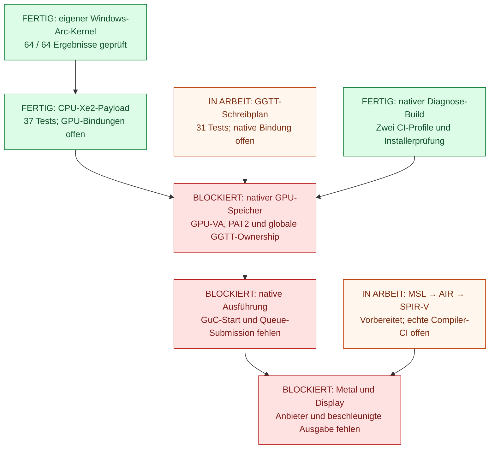

[](LICENSE)
[](https://github.com/IT-EXPRESS-Bayern/LunarBridge-Hackintosh/actions/workflows/native-build.yml)
[](https://github.com/IT-EXPRESS-Bayern/LunarBridge-Hackintosh/actions/workflows/metal-shader.yml)


# LunarBridge

**Native macOS-Treiberentwicklung für Intel Lunar Lake und Arc 130V.**

[English](README.md) · [Repository](https://github.com/IT-EXPRESS-Bayern/LunarBridge-Hackintosh) · [Geprüfter Stand](docs/VALIDATION.md)

LunarBridge liefert derzeit eine gebaute **native Diagnose-Kext**, Tracker und
Trace-Werkzeuge, einen OpenCore-Installer mit Rücknahme und geprüfte CPU-seitige
Xe2-Shader- und Speicherbausteine. **Native Arc-130V-GPU-Ausführung, ein
Metal-Anbieter und beschleunigte Displayausgabe sind noch nicht implementiert.**
Die Workflow-Badges zeigen Buildjobs und bestätigen keine Geräteunterstützung.
Der Nachweis der echten Shader-Compiler-CI steht noch aus.

Erstes Ziel ist das **Samsung Galaxy Book5 Pro 16 (NP960XHA-KG3DE)** mit Intel
Core Ultra 5 226V und Arc 130V: PCI `8086:64A0`, Samsung-Subsystem `144D:C1DD`.
Vorgesehen sind natives macOS Tahoe auf einer externen USB-C-SSD, Windows auf
dem internen Laufwerk und eine Auswahl beim Start. Diese Installation ist auf
dem Laptop noch nicht qualifiziert.

## Was ist fertig, in Arbeit oder blockiert?

Grün bedeutet im angegebenen Umfang nachgewiesen; Orange bedeutet vorbereitete
Arbeit oder ausstehende Integration; Rot bedeutet eine fehlende Voraussetzung
für den nativen Grafikpfad. Pfeile zeigen Abhängigkeiten, keine bereits laufende
GPU-Pipeline.



| Baustein | Stand | Aussage des Nachweises |
| --- | --- | --- |
| Eigener Xe2-Kernel | **Fertig — Windows** | Eine echte OpenCL-Ausführung auf der Arc 130V; 64/64 korrekte Werte. [Nachweis und Fixtures](gpu-toolchain/README.md) |
| Diagnose-Kext + Installer | **Fertig — Build/Paket** | Beide nativen CI-Profile bestanden; unsignierte Diagnose-Kext. [Prüfbericht](docs/VALIDATION.json) |
| Nativer Main-GT-Forcewake | **In Arbeit — Gerätequalifikation** | Implementiert und mit Hosttests geprüft; standardmäßig aus, keine native Samsung-Probe. [Bring-up](docs/GPU_BRINGUP.md) |
| Eigene CPU-Shader-Payload | **Fertig — CPU-Format** | 37 Payloadtests plus 37 historische Inspectorprüfungen; GPU-Pointer bleiben offen. [Payloadvertrag](gpu-toolchain/KERNEL_PAYLOAD.md) |
| GGTT-Schreibplan | **Fertig — CPU-Planer** | 31 Tests / 132 echte C++-Aufrufe; Host-DLL und macOS-Objektbuild integriert, keine Hardwarebindung. [GGTT](docs/GGTT_BINDING.md) |
| GuC-Schedulercodec | **Fertig — CPU-Protokoll** | 25 Prüfungen des tatsächlichen C++-Codecs; Register-/Mode-/Submit-/Deregister-Nachrichten, keine laufende Firmware oder Queue. [Schedulervertrag](docs/GUC_SCHEDULER.md) |
| MSL → AIR → Shader-SPIR-V | **In Arbeit — Compilerqualifikation** | 64 Offlineprüfungen bestanden; echte MSL- und LLVM-Befehle erfolgreich, danach private AIR-Metadaten verweigert. Begrenzte Klassifikation und echte Compilerhilfe diagnostizieren das Feld; Übersetzung bleibt ungeprüft. [Compilerbrücke](docs/METAL_SHADER_BRIDGE.md) |
| Mesa-CPU-Parser | **In Arbeit — Herkunftsnachweis** | 29 Offlineprüfungen bestanden; das gepinnte `spirv2nir` in echter CI gebaut. Streaminghashes prüfen jetzt auch seine große erzeugte NIR-Quelle; Binary-/Hilfe-/Quellenabnahme bleibt offen. [Backend-Anschlüsse](docs/METAL_BACKEND_SEAMS.md) |
| Arc-Schnittstellenvertrag | **Fertig — CPU-Vertrag** | 46 Prüfungen der kompilierten Tabelle und 13 gegen die gepinnten Quellen; die 12 Linux-Arc-ioctls auf die macOS-26-Externalmethod-Form abgebildet und abweichungsfrei verifiziert. Apples jüngster Intel-Treiber ist Gen11, ein Xe2-Treiber zur Übernahme existiert nicht. [Schnittstellenvergleich](docs/ARC_INTERFACE_DIFF.md) |
| macOS-ABI-Erhebung | **Fertig — Werkzeug, noch unbenutzt** | Der veröffentlichte Prüfvertrag aus gepinnter xnu-Quelle geparst und von clang zertifiziert; ein Selektor-Tabellen-Scanner, belegt gegen compilergenerierte, gestrippte, Legacy-, relokatierbare und Kernel-Collection-Bilder; Plattform- und Grafikstapel-Erheber. 82 Tests. Noch kein Apple-Binary gelesen. [Runbook](docs/ABI_RECOVERY.md) |
| Recon-Audit | **Fertig — ein Befehl** | Ein Lauf baut beide Bibliotheken mit `-Werror`, führt alle 20 Suiten aus (510 Tests), verifiziert die 58 gepinnten Quellen, leitet 73 Upstream-Fakten mit Zeilenzitat neu her und sortiert, was offen ist; 27 Tests halten die eigenen Zusagen fest. [Recon](docs/RECON.md) |
| Portierte Xe2-PAT- und LRC-Verträge | **Fertig — CPU-Port** | 31 Tests, deren Erwartungswerte aus den gepinnten Intel-MIT-Quellen geparst werden: die 32er-PAT-Tabelle mit Schreibplan sowie Layout, Kontextimage, Deskriptor und Ringprolog des Render-/Compute-LRC. Es wird nichts programmiert oder submittiert. [Linux-Port](docs/ARC_PORT_FROM_LINUX.md) |
| Nativer Speicher + Ausführung | **Blockiert — Implementierung fehlt** | GPU-VA-Bindung, programmierter PAT2, globale GGTT-Ownership, GuC-Start und Queue-Submission fehlen. [Architektur](docs/GPU_DESIGN.md) |
| Metal-Anbieter + Display | **Blockiert — Implementierung fehlt** | Kein LunarBridge-System-Metal-Anbieter, keine beschleunigte Ausgabe oder WindowServer-Anbindung. [Hardwareumfang](docs/HARDWARE_SUPPORT.md) |

Das geprüfte Diagnosepaket stammt aus [Build 38132276514](https://github.com/IT-EXPRESS-Bayern/LunarBridge-Hackintosh/actions/runs/38132276514)
zum Quellstand [3b7550d](https://github.com/IT-EXPRESS-Bayern/LunarBridge-Hackintosh/commit/3b7550d154ee017487c1858591af2d02f4cbed05):
**78.960 Byte Kernelbinary**, 28 entsprechende Quelldateien gegen diesen Commit
geprüft und erfolgreiche `plan`-/`install`-/`rollback`-Aufrufe der tatsächlich
verpackten Installer-CLI für beide Profile in künstlichen EFIs. GGTT-Planer
und GuC-Schedulercodec sind im Binary enthalten. Spätere Compilerarbeit hat
eigene Nachweise und bleibt vom Diagnosepaket getrennt.

Ein separater [Metal-Funktionstest](docs/METAL_VALIDATION.json) bestand auf
einem Intel-macOS-CI-Host mit 65.536 korrekten Ausgaben. Er nutzte dessen
vorhandenen Metal-Anbieter. Dieser CI-Rechner ist nicht das Samsung und bestätigt
keinen LunarBridge-Arc-Treiber. **Keine native macOS-Hardwareprobe auf dem
Samsung ist bisher bestanden.**

## Unter Windows entwickeln und prüfen

Benötigt werden Python 3.12+, der portable Compiler **Zig 0.15.2** und externe
MacKernelSDK-Header. Im Repository-Stamm ausführen und eigene Pfade einsetzen:

```powershell
python tools/fetch_references.py
python gpu-prototype/build_gpu.py --compiler C:/path/to/zig.exe --sdk C:/path/to/MacKernelSDK --host-dir build/host --object-dir build/macos
python gpu-prototype/test_gpu_foundation.py build/host/lnl_host.dll
python -m unittest discover -s gpu-toolchain/tests -p test_xe2_shader.py
python -m unittest discover -s gpu-toolchain/tests -p test_own_kernel_payload.py
```

Damit entstehen die Windows-Test-DLL und macOS-Objektdateien; die Prüfungen
laufen auf der CPU beziehungsweise offline. Unter Windows wird keine Kext
gelinkt oder geladen. Die integrierte Hostbibliothek enthält auch den
[GGTT-Planer](docs/GGTT_BINDING.md) und [GuC-Codec](docs/GUC_SCHEDULER.md).
Der [Prüfstand](docs/VALIDATION.md) nennt die weiteren Tests mit ihren jeweiligen
Grenzen. Die [Hardwarevarianten](docs/HARDWARE_VARIANTS.md) erklären, weshalb
die gemeinsame Intel-Geräte-ID hilft und welche OEM-Display- und
Laufzeitbedingungen zusätzlich zu prüfen sind.

## Die echte native Diagnose-Kext bauen

Auf einem Intel-Mac mit Xcode Command Line Tools, Python und dem externen SDK:

```sh
python3 tools/build_native.py --sdk /path/to/MacKernelSDK --out build/native
```

Derselbe [native Buildworkflow](.github/workflows/native-build.yml) läuft auf
einem Intel-macOS-26-CI-Host mit gepinntem SDK-Checkout. Er erzeugt
`build/native/LunarBridge.kext`, `LunarBridge-Installer.zip` und einen Buildbericht,
einschließlich entsprechendem Quellcode und Lizenzhinweisen. Die Kext ist
unsigniert; Kompilieren und Linken belegen weder das Laden auf dem Zielgerät
noch GPU-Ausführung. Für diese Entwicklung steht lokal kein Mac bereit.

MMIO, DMA-Vorbereitung und Forcewake-Probe sind standardmäßig deaktiviert. Die
ausdrücklichen Optionen und noch offenen Geräteprüfungen stehen in
[GPU-Bring-up](docs/GPU_BRINGUP.md), [DMA-Anschluss](docs/DMA_BACKEND.md) und
[nativem Dienst](docs/NATIVE_BACKEND.md).

## Installer, Traces und Bootziel

Der [Installer](docs/INSTALLER.md) verwaltet ausschließlich die Grafik-Diagnose-Kext
in einer ausdrücklich ausgewählten OpenCore-EFI: `plan`, gesichertes `install`
und `rollback`. Er partitioniert keine SSD und stellt keinen fertigen Dualboot her.
Die [macOS-Sammler- und Trace-Anleitung](docs/DIAGNOSTICS.md) beschreibt Snapshots,
begrenzte Ereignisse und Fehlerauswertung; die [Diagnose-Issue-Vorlage](.github/ISSUE_TEMPLATE/native-diagnostics.yml)
ordnet Berichte ihrem Quellstand und ihrer Phase zu.

Firmware-UEFI-Secure-Boot ist für den ersten nativen Versuch zurückgestellt;
das strenge Profil bleibt zur späteren Qualifikation in den separaten
[OpenCore-Testprofilen](https://github.com/IT-EXPRESS-Bayern/LunarBridge-OpenCore/blob/main/docs/TEST_PROFILES.md)
erhalten. SIP und AMFI bleiben im Testplan aktiviert. Startauswahl, Firmware-Vertrauen,
Installation auf der externen SSD, Display und Standby brauchen weiterhin
tatsächliche Samsung-Proben.

## Sieben eigenständige Module

Hardwaretreiber bleiben getrennte Bundles; Kompatibilitätswerkzeuge sind
Userland-Module. Jedes größere Modul hat ein eigenes Repository und eigene
Prüfungen. Die Paketgrenzen stehen in [Treibermodule](docs/DRIVER_MODULES.md).

| Modul | Repository |
| --- | --- |
| Grafik, Diagnosen und Grafik-Installer | [LunarBridge-Hackintosh](https://github.com/IT-EXPRESS-Bayern/LunarBridge-Hackintosh) |
| I2C, GPIO und HID | [LunarBridge-I2C](https://github.com/IT-EXPRESS-Bayern/LunarBridge-I2C) |
| HDR und Samsung-Einstellungen | [LunarBridge-HDR-Samsung](https://github.com/IT-EXPRESS-Bayern/LunarBridge-HDR-Samsung) |
| Native Softwarekompatibilität | [LunarBridge-Native-Compatibility](https://github.com/IT-EXPRESS-Bayern/LunarBridge-Native-Compatibility) |
| Windows-Programme / Wine | [LunarBridge-Windows-Compatibility](https://github.com/IT-EXPRESS-Bayern/LunarBridge-Windows-Compatibility) |
| IPU7 / OV02E10 Kamera | [LunarBridge-Camera](https://github.com/IT-EXPRESS-Bayern/LunarBridge-Camera) |
| OpenCore, Dualboot und Vertrauenskette | [LunarBridge-OpenCore](https://github.com/IT-EXPRESS-Bayern/LunarBridge-OpenCore) |

## Community-Entwicklung und spätere Grafikports

LunarBridge soll eine gemeinsame Basis für den Aufbau und die Modifikation
nativer Treiber werden. Der [Arc-Schnittstellenvergleich](docs/ARC_INTERFACE_DIFF.md)
stellt die Schnittstelle des Linux-Arc-130V-Treibers operationsweise gegen den
macOS-26-Kernelkontrakt und hält fest, was die macOS-geformte Operationstabelle
geändert hat und warum. Der [Linux-Port](docs/ARC_PORT_FROM_LINUX.md) geht den
Schritt weiter: Die Xe2-PAT- und LRC-Verträge sind in diesen Treiber portiert,
geformt nach der letzten Apple-kompatiblen Treibergeneration, mit Nachweis je Wert.
Für die macOS-Hälfte, die keine veröffentlichte Quelle abdeckt, beschreibt die
[Apple-Treiberanalyse](docs/APPLE_DRIVER_ANALYSIS.md), wie sich die
Schnittstelle eines lokal installierten Gen11-Treibers erheben lässt — nur
Namen, Zahlen und Hashes, das Binary bleibt, wo es ist.
[`tools/recon.py`](tools/recon.py) führt all das in einem Befehl aus und
schreibt einen sortierten Befundbericht; siehe [Recon](docs/RECON.md). Was für
Beschleunigung noch fehlt, ist die private macOS-Schnittstelle; die
[ABI-Erhebung](docs/ABI_RECOVERY.md) ist das Runbook, um sie auf der
Zielmaschine zu erheben — nur Schnittstellenfakten, kein Apple-Code. Die [Architektur und Modulverträge](docs/ARCHITECTURE.md)
erklären die Bausteingrenzen; die [Portierungsanleitung](docs/PORTING_GUIDE.md)
beschreibt Wiederverwendung, generationsabhängige Arbeit, Tests und Lizenzen.
Nach Fertigstellung und Qualifikation des ersten nativen Arc-130V-Pfads sollen
weitere Grafikeinheiten folgen. Jeder Port braucht eigene Geräte-, ABI- und
Firmwareverträge sowie einen tatsächlichen Hardware-Nachweis.

## Lizenz und Upstream-Arbeit

Eigene LunarBridge-Arbeit steht unter **GPL-3.0-only**. Kommerzielle Nutzung und
bezahlter Support sind erlaubt; bei Weitergabe erfasster Arbeit gelten die
GPL-Pflichten einschließlich des entsprechenden Quellcodes. Siehe [LICENSE](LICENSE)
und [Lizenzumfang](docs/LICENSING.md). Intel-MIT-Referenzen, die LGPL-Lizenz des
externen Konverters, Apple-Referenzheader, SDKs, Firmware und Abhängigkeiten
der separaten Module behalten ihre jeweiligen Lizenzen. Siehe [NOTICE](NOTICE)
und [Lizenzstatus](LICENSE-STATUS.txt). Proprietäre Apple- oder Windows-Treiber
werden in diesem Repository nicht weitergegeben.
