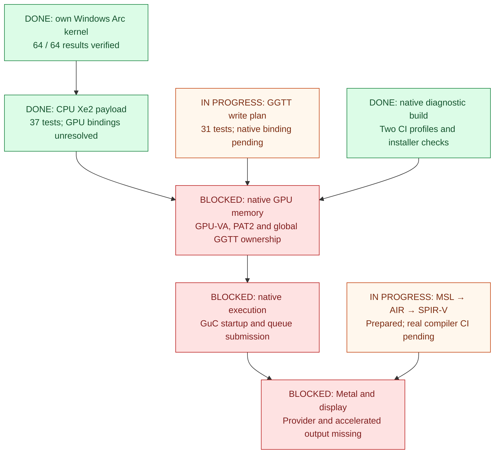

[](LICENSE)
[](https://github.com/IT-EXPRESS-Bayern/LunarBridge-Hackintosh/actions/workflows/native-build.yml)
[](https://github.com/IT-EXPRESS-Bayern/LunarBridge-Hackintosh/actions/workflows/metal-shader.yml)


# LunarBridge

**Native macOS driver research for Intel Lunar Lake and Arc 130V.**

[Deutsch](README.de.md) · [Repository](https://github.com/IT-EXPRESS-Bayern/LunarBridge-Hackintosh) · [Verified evidence](docs/VALIDATION.md)

The `research/metal-contract` branch also contains [offline recovery graphics
analysis](docs/RECOVERY_GRAPHICS.md): actual Metal/IOAccelerator observations,
an original read-only parser, 32 synthetic format tests and reproducible steps
for contributors. The source image was inspected on Windows before installing
macOS; native Arc acceleration remains unqualified.

The subsequent [IOKit call investigation](docs/IOACCEL_CALLS.md) records 78 call
sites from 216 functions, connection types and concrete structure sizes for
Device, Shared Memory and Command Queue. An additional read-only tool and 24
synthetic tests make these findings reproducible.

LunarBridge currently provides a built **native diagnostic Kext**, tracker and
trace tools, an OpenCore installer with rollback, and tested CPU-side Xe2 shader
and memory components. **Native Arc 130V GPU execution, a Metal provider and
accelerated display are not implemented.** The workflow badges show build jobs;
they do not certify target-device support. Real shader-compiler CI evidence is
still pending.

The initial target is the **Samsung Galaxy Book5 Pro 16 (NP960XHA-KG3DE)** with
Intel Core Ultra 5 226V and Arc 130V: PCI `8086:64A0`, Samsung subsystem
`144D:C1DD`. The intended installation is native macOS Tahoe on an external
USB-C SSD, Windows on the internal disk, and a choice at boot. That installation
has not been qualified on this laptop.

## What is finished, in progress or blocked?

Green means verified within the stated scope; orange means prepared work or
pending integration; red means a required native implementation is missing.
Arrows show dependencies, not an already running GPU pipeline.



| Component | State | What the evidence establishes |
| --- | --- | --- |
| Own Xe2 kernel | **Done — Windows** | One real Arc 130V OpenCL run; 64/64 correct outputs. [Proof and fixtures](gpu-toolchain/README.md) |
| Diagnostic Kext + installer | **Done — build/package** | Both native CI profiles passed; unsigned diagnostic bundle. [Validation](docs/VALIDATION.json) |
| Native Main-GT forcewake | **In progress — target qualification** | Implemented and host-tested; off by default, no native Samsung test. [Bring-up](docs/GPU_BRINGUP.md) |
| Own CPU shader payload | **Done — CPU format** | 37 payload tests plus 37 historical inspector tests; GPU pointers remain unresolved. [Payload contract](gpu-toolchain/KERNEL_PAYLOAD.md) |
| GGTT write plan | **Complete — CPU planner** | 31 tests / 132 actual C++ calls; integrated host DLL and macOS object build, no hardware binding. [GGTT](docs/GGTT_BINDING.md) |
| GuC scheduler codec | **Complete — CPU protocol** | 25 tests at the production C++ codec; register/mode/submit/deregister messages, no live firmware or queue. [Scheduler contract](docs/GUC_SCHEDULER.md) |
| MSL → AIR → Shader SPIR-V | **In progress — compiler qualification** | 64 offline tests passed; real MSL and LLVM commands succeeded, then private AIR metadata was refused. A bounded classifier and real compiler help diagnose that field; translation remains unverified. [Compiler bridge](docs/METAL_SHADER_BRIDGE.md) |
| Mesa CPU parser | **In progress — provenance qualification** | 29 offline tests passed; pinned `spirv2nir` built on real CI. Streaming hashes now handle its large generated NIR source; binary/help/source qualification remains open. [Backend seams](docs/METAL_BACKEND_SEAMS.md) |
| Native memory + execution | **Blocked — implementation missing** | GPU-VA binding, programmed PAT2, global GGTT ownership, GuC startup and queue submission remain missing. [Architecture](docs/GPU_DESIGN.md) |
| Metal provider + display | **Blocked — implementation missing** | No LunarBridge system Metal provider, accelerated display or WindowServer integration. [Hardware scope](docs/HARDWARE_SUPPORT.md) |

The verified diagnostic artifact comes from [build 38132276514](https://github.com/IT-EXPRESS-Bayern/LunarBridge-Hackintosh/actions/runs/38132276514)
at source [3b7550d](https://github.com/IT-EXPRESS-Bayern/LunarBridge-Hackintosh/commit/3b7550d154ee017487c1858591af2d02f4cbed05):
a **78,960-byte kernel binary**, 28 corresponding-source files checked against
that commit, and packaged installer CLI plan/install/rollback checks for both
profiles in synthetic EFIs. The binary contains the GGTT planner and GuC
scheduler codec. Later compiler work has its own evidence and is separate
from this diagnostic artifact.

A separate [Metal smoke test](docs/METAL_VALIDATION.json) passed on an Intel
macOS CI host with 65,536 correct outputs. It used that host's existing Metal
provider. The CI host is not the Samsung and this result does not validate a
LunarBridge Arc driver. **No native Samsung macOS hardware test has passed.**

## Develop and check on Windows

Use Python 3.12+, portable **Zig 0.15.2** and external MacKernelSDK headers.
Run from the repository root; substitute your own compiler and SDK paths:

```powershell
python tools/fetch_references.py
python gpu-prototype/build_gpu.py --compiler C:/path/to/zig.exe --sdk C:/path/to/MacKernelSDK --host-dir build/host --object-dir build/macos
python gpu-prototype/test_gpu_foundation.py build/host/lnl_host.dll
python -m unittest discover -s gpu-toolchain/tests -p test_xe2_shader.py
python -m unittest discover -s gpu-toolchain/tests -p test_own_kernel_payload.py
```

This builds the Windows test DLL and macOS object files, and runs CPU/offline
checks. It does not link or load a Kext on Windows. The integrated host library
also contains the [GGTT planner](docs/GGTT_BINDING.md) and [GuC codec](docs/GUC_SCHEDULER.md).
The [validation record](docs/VALIDATION.md) lists the other test suites and their
specific limits. [Hardware variants](docs/HARDWARE_VARIANTS.md) explains why
the common Intel device ID is useful while OEM display and runtime qualification
remain separate requirements.

## Build the real native diagnostic bundle

On an Intel Mac with Xcode Command Line Tools, Python and the external SDK:

```sh
python3 tools/build_native.py --sdk /path/to/MacKernelSDK --out build/native
```

The same [native build workflow](.github/workflows/native-build.yml) runs on an
Intel macOS 26 CI host with a pinned SDK checkout. It produces
`build/native/LunarBridge.kext`, `LunarBridge-Installer.zip` and a build report,
including corresponding source and license notices. The bundle is unsigned;
successful compilation and linking do not establish target loading or GPU
execution. There is no local Mac available for this development setup.

MMIO, DMA preparation and forcewake probing are disabled by default. Their
explicit options and remaining device checks are in [native bring-up](docs/GPU_BRINGUP.md),
[DMA backend](docs/DMA_BACKEND.md) and [native service](docs/NATIVE_BACKEND.md).

## Installer, traces and boot target

The [installer](docs/INSTALLER.md) manages only the graphics diagnostic Kext in
an explicitly selected OpenCore EFI: `plan`, backed-up `install` and `rollback`.
It does not partition the SSD or establish a working dual boot.
The [macOS collector and trace guide](docs/DIAGNOSTICS.md) explains snapshots,
bounded events and failure triage; the [diagnostic issue template](.github/ISSUE_TEMPLATE/native-diagnostics.yml)
keeps reports tied to their source and phase.

Firmware UEFI Secure Boot is deferred for the first native attempt, with the
strict profile retained for later qualification in the separate
[OpenCore test profiles](https://github.com/IT-EXPRESS-Bayern/LunarBridge-OpenCore/blob/main/docs/TEST_PROFILES.md).
SIP and AMFI remain enabled in the test plan. Boot selection, firmware trust, external-SSD
installation, display and sleep/wake still need actual Samsung tests.

## Seven independent modules

Hardware drivers remain separate bundles; compatibility tools remain user-space
modules. Each larger module has its own repository and validation. Package
boundaries are documented in [driver modules](docs/DRIVER_MODULES.md).

| Module | Repository |
| --- | --- |
| Graphics, diagnostics and graphics installer | [LunarBridge-Hackintosh](https://github.com/IT-EXPRESS-Bayern/LunarBridge-Hackintosh) |
| I2C, GPIO and HID | [LunarBridge-I2C](https://github.com/IT-EXPRESS-Bayern/LunarBridge-I2C) |
| HDR and Samsung settings | [LunarBridge-HDR-Samsung](https://github.com/IT-EXPRESS-Bayern/LunarBridge-HDR-Samsung) |
| Native application compatibility | [LunarBridge-Native-Compatibility](https://github.com/IT-EXPRESS-Bayern/LunarBridge-Native-Compatibility) |
| Windows executables / Wine | [LunarBridge-Windows-Compatibility](https://github.com/IT-EXPRESS-Bayern/LunarBridge-Windows-Compatibility) |
| IPU7 / OV02E10 camera | [LunarBridge-Camera](https://github.com/IT-EXPRESS-Bayern/LunarBridge-Camera) |
| OpenCore, dual boot and trust chain | [LunarBridge-OpenCore](https://github.com/IT-EXPRESS-Bayern/LunarBridge-OpenCore) |

## Community development and future GPU ports

LunarBridge is intended as a shared foundation for building and modifying native
drivers. The [architecture and module contracts](docs/ARCHITECTURE.md) explain
component boundaries; the [porting guide](docs/PORTING_GUIDE.md) describes reuse,
generation-specific work, tests and licensing. After the initial native Arc
130V path is completed and qualified, other graphics units are intended follow-up
targets. Each port needs its own device, ABI and firmware contracts plus actual
hardware evidence.

## License and upstream work

Own LunarBridge work is **GPL-3.0-only**: commercial use and paid support are
allowed, with the GPL's corresponding-source obligations when covered work is
distributed. See [LICENSE](LICENSE) and [licensing scope](docs/LICENSING.md).
Intel MIT references, the external converter's LGPL license, Apple reference
headers, SDKs, firmware and separate-module dependencies retain their original
licenses. See [NOTICE](NOTICE) and [license status](LICENSE-STATUS.txt).
This repository does not redistribute proprietary Apple or Windows drivers.
