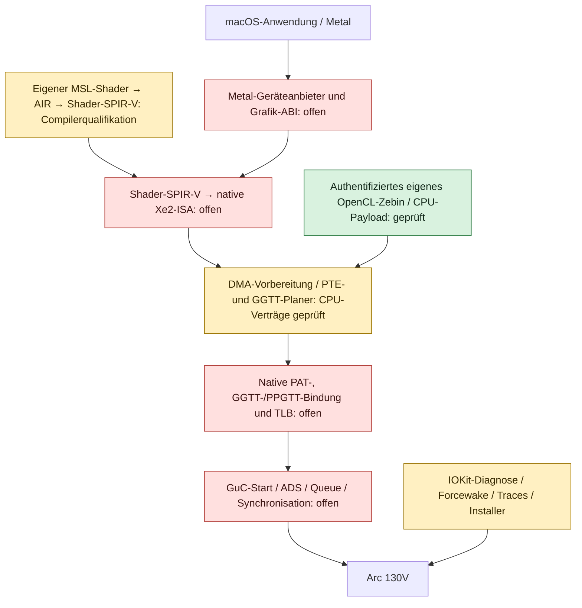

# Treiberaufbau und Herkunft der Änderungen

Stand: 11. Oktober 2026. Dieses Dokument beschreibt den implementierten
Prototyp und seine Grenzen. Ein funktionsfähiger nativer Arc-130V-Metal-Treiber
ist noch nicht vorhanden. Nach jedem qualifizierten Hardwaremeilenstein werden
Aufbau, Änderungen und Nachweise hier ergänzt.

LunarBridge entwickelt den Grafikpfad für Intel Lunar Lake / Xe2 auf einem
Samsung mit PCI `8086:64A0`, Subsystem `144D:C1DD`. Andere Geräte erhalten keine
Unterstützungszusage durch eine zusätzliche PCI-ID. Die
[Hardwarevarianten](HARDWARE_VARIANTS.md) belegen den gemeinsamen Linux-LNL-Match
und die getrennten Anforderungen für Compute und OEM-Displaydaten. Der
[Mesa-Compileranschluss](METAL_BACKEND_SEAMS.md) beschreibt die tatsächlichen
NIR-/BRW-APIs, Bindungs- und Dispatchverträge für einen künftigen Xe2-Compiler.

Die zwei Compilerwege haben unterschiedliche Verträge. Das eigene unter Windows
ausgeführte OpenCL-Zebin belegt einen Xe2-Kernel und dessen OpenCL-Payload. Die
Metal-Übersetzung erzeugt Vulkan-Shader-SPIR-V. Diese Ausgabe darf nicht als
OpenCL-Zebin behandelt werden; ein nativer Compilerbackend fehlt zwischen diesen
Stufen. Auch eine erfolgreiche MSL-Übersetzung registriert kein Metalgerät.

## Implementierte Bausteine

| Baustein | Aufgabe und Schnittstelle | Aktuelle Grenze |
| --- | --- | --- |
| `gpu-prototype/lnl_platform.*` | Enge PCI-Zuordnung und GMD/IP-Dekodierung | Kein Framebuffer und keine Geräteemulation |
| `gpu-prototype/lb_forcewake.*` | Zeitbegrenztes, gepaartes GT-Wake-/Release-Protokoll mit Zustandsprüfung | Registercallbacks wurden auf dem Host geprüft; Samsung-MMIO fehlt |
| `native/LBForceWakeAdapter.*` | Geräte-/Power-/BAR-Prüfung, Lunar-Lake-Lese-Workaround, Mapping-Lifetime | Hardwarefehler und native Power-Races bleiben unqualifiziert |
| `native/LunarBridgeDriver.*` | IOKit-Diagnoseservice, privilegierter UserClient, Ressourcen und Snapshot | GPU-Submit bleibt nicht unterstützt |
| `native/LBDMAContext.*` | Vorbereitung über den Geräte-DMA-Mapper und geordnete Freigabe | Keine GPU-Seitentabellenbindung; bisheriges PAT0-Staging ist kein PAT2-Nachweis |
| `native/LBDMAQuarantine.*` | Eigentümerbindung und spätere Freigabe ungelöster DMA-Ressourcen | Kein Nachweis nativer Kernelkonkurrenz oder Gerätefunktion |
| `gpu-prototype/lb_gpu_memory.*` | Reservierungen, PTE-Formate und Prüfung segmentierter DMA-Seiten | CPU-Planung mit expliziten Eingaben |
| `gpu-prototype/lb_ggtt_plan.*` | Getrennte PPGTT-/GGTT-Reservierungen zu BAR-Offset/PTE-Schreibplan verbinden | Keine BAR-Schreibvorgänge, globale Hardwarebelegung oder TLB-Freigabe |
| `gpu-prototype/lb_guc_scheduler.*` | Geprüfter serieller Register-/Mode-/Submit-/Deregister-Nachrichtencodec mit Revision und begrenztem Fence-Verlauf | CPU-Protokoll; keine laufende Firmware, ADS/LRC oder echte Submission |
| `gpu-prototype/lb_xe2_pat.*` | Portierte Lunar-Lake-PAT-Tabelle, Registeroffsets, geordneter Schreibplan und Lesekontrolle | Kein MMIO; Forcewake, BAR-Besitz und Readback bleiben Aufgabe des Aufrufers |
| `gpu-prototype/lb_lrc.*` | Portiertes Xe2-LRC-Layout, Kontextimage-Schreibvorgänge, Ringsteuerwort, PPGTT-Wurzel, Ringprolog und Kontextdeskriptor | CPU-Speicher; keine GGTT-Bindung, keine Registrierung, kein Submit |
| `gpu-prototype/lb_arc_interface.*` | macOS-geformte Arc-Operationstabelle aus der Xe-uAPI, Prüfung der Externalmethod-Aufrufform und Validierung/Übersetzung einer flachen Anfrage | CPU-Vertrag; akzeptierte Form ist keine Submission, keine Hardwarebindung |
| `gpu-prototype/lb_guc_firmware.*` und `lb_guc_transport.*` | CSS-Metadatenprüfung, HXG und CT-Ringschatten | Keine authentifizierte laufende Firmware oder echte CT-Queue |
| `gpu-toolchain/own_kernel_payload.py` | Eigenes unverändertes Zebin prüfen und 64/32/32-Byte-Payload vorbereiten | Beide GPU-Adressen unaufgelöst; kein WALKER oder Dispatch |
| `tools/metal_shader_ci.py` | Eigene MSL/AIR/SPIR-V-Ausgaben und Reflection des externen Konverters qualifizieren | Compilererfolg ist vom nativen GPU-/Metalbetrieb getrennt |
| `tools/collect_macos.py` und `analyze_trace.py` | Snapshots und begrenzte Traces sammeln und Fehler einordnen | Kein erfundener Hardwareerfolg aus fehlenden oder alten Daten |
| `installer/install_opencore.py` | Gewähltes Grafik-Kext planen, sichern, installieren und zurücknehmen | Installer-Tests liefen an künstlichen EFIs; Boot und Kext-Akzeptanz offen |
| `tools/recon.py` | Ein Lauf: bauen, alle Suiten fahren, gepinnte Quellen verifizieren, Upstream-Fakten mit Zeilenzitat neu herleiten, Apple-Bundles und lebenden Grafikstapel lesen, Befunde sortieren | Nur lesend; schreibt allein ins Ausgabeverzeichnis und belegt keinen Hardwarezustand |

Das [Recon-Audit](RECON.md) fasst diese Werkzeuge in einem Einstiegspunkt
zusammen und schreibt einen sortierten Befundbericht; sein Exit-Code meldet
Drift, Build- oder Testfehler, nicht offene Portierungsarbeit.

Der [Linux-Port](ARC_PORT_FROM_LINUX.md) beschreibt die erste portierte Etappe:
PAT-Programmierplan und LRC-Kontextaufbau für Arc 130V, mit Zeilennachweis je
Wert in [ARC_PORT_SOURCES.json](ARC_PORT_SOURCES.json).

Die [Schnittstellenanalyse](ARC_INTERFACE_DIFF.md) vergleicht die 12 ioctls des
Linux-Arc-130V-Treibers mit dem macOS-26-Kernelkontrakt und belegt, dass Apples
jüngster Intel-Grafiktreiber Ice Lake / Gen11 ist: Für Xe2 existiert kein
Apple-Treiber, der übernommen werden könnte. Selector 7 und 8 veröffentlichen
die daraus abgeleitete Operationstabelle und prüfen eine Anfrageform.

Der Forcewake-Status ergänzt die bestehende UserClient-ABI mit Selector 6 und
einem 80-Byte-Bericht. GPU-Ausführung und Metal-Nachweis bleiben darin 0. Trace-
Ereignisse 50 bis 53 erfassen Abschluss, Fehler und Freigabefehler des Wakepfads.
Die bisherigen Methoden bleiben erhalten. Eine zukünftige ABI-Änderung muss
Größen, Versionen, Byteordnung und Rückwärtskompatibilität dokumentieren.

## Was wurde modifiziert, was wurde neu geschrieben?

Die eigene Grafik-Kext und die CPU-Helfer werden in diesem Repository entwickelt.
Der Windows-Intel-Treiber wird nicht als macOS-Kext verwendet. Es wurde kein
proprietärer Apple-Intel-Metal-Treiber in einen Xe2-Treiber umbenannt und kein
Linux-Kernelmodul als Darwin-Treiber eingebunden.

Aus dem Intel-Xe-/Compute-Runtime-Quellcode werden konkrete Hardwareverträge
untersucht: Register, PTE/PAT-Format, Payload-Layout und Relokationsbedeutung.
Die entsprechenden Commits, vollständigen Quelldatei-Hashes und Lizenzhinweise
stehen in [GGTT_BINDING_SOURCES.json](GGTT_BINDING_SOURCES.json),
[KERNEL_PAYLOAD_SOURCES.json](../gpu-toolchain/KERNEL_PAYLOAD_SOURCES.json)
und den jeweils verlinkten Modulunterlagen. Vollständige Fremdtreiber werden
nicht in die Grafik-Kext eingebaut.

`steelbrain/metal2vulkan` ist eine externe, exakt gepinnte Compilerabhängigkeit
unter LGPL-3.0-or-later. Der eigene GPL-3.0-only-Harness prüft Quellen, Lizenz,
Werkzeuge, tatsächlich erzeugten Cargo-Lock, Abhängigkeiten und Ausgaben.
Erfolg benötigt echte Compilerartefakte und unabhängige SPIR-V-Validierung.
Versionsnummern werden aus dem gepinnten Rust-Code geprüft; seine ältere
Reflection-Dokumentation war für diesen Pin nicht maßgeblich.

## Eigentum, Lebensdauer und Fehler

GPU-Speicher gehört zu einer geprüften Gerätezuordnung und einem Besitzer mit
gültigem Token. Systemadressen, Geräte-DMA-Adressen und GPU-virtuelle Adressen
sind unterschiedliche Dinge. Der Code darf sie nicht gegenseitig ersetzen.
PPGTT und GGTT besitzen unterschiedliche Eintragsformate und Reservierungen;
GGTT-Schreibpläne müssen erneut nach dem GGTT-Vertrag kodiert werden.

Ein Mapping oder Geräte-Open wird erst freigegeben, wenn der dazugehörige
Vorgang bestätigt abgeschlossen ist. Fehler können Hardwarezustände ungelöst
lassen. Die Diagnose meldet diesen Zustand, statt eine erfolgreiche Freigabe
anzunehmen. Ein reiner CPU-Zustandswechsel beweist keine GPU-Ausführung.

Die Kext enthält nur Grafikfunktionen. Eingabe, Kamera, HDR/Samsung-Werkzeuge,
Softwarekompatibilität und OpenCore bleiben getrennte Projekte. Firmware-Secure-
Boot ist für den ersten nativen Versuch zurückgestellt; dies ist keine
automatische Änderung von SIP, AMFI, Gatekeeper oder Apples SecureBootModel.

## Welche Nachweise die Community erhält

Jeder bestätigte Meilenstein muss auf einen exakten Quellcommit, Buildwerkzeuge,
Artefakthashes und Testart verweisen. Hosttests, macOS-Builds, CI-GPU-Läufe und
Samsung-Gerätetests werden getrennt ausgewiesen. Die aktuelle Übersicht steht
in [VALIDATION.md](VALIDATION.md) und [VALIDATION.json](VALIDATION.json).

Vor einer Funktionszusage gehören zusätzlich ein tatsächlich geladener Treiber,
geprüfte GPU-Speicherbindung, eigener Dispatch mit unabhängig verifizierten
Ergebnissen, Fehler-/Resetverhalten und schließlich Metal-/Displaytests dazu.
Bei der späteren Erstfreigabe wird dieser Leitfaden um die endgültigen
Initialisierungsfolgen, Änderungen gegenüber den Primärquellen, bekannte Grenzen
und reproduzierbare Geräteproben ergänzt.
